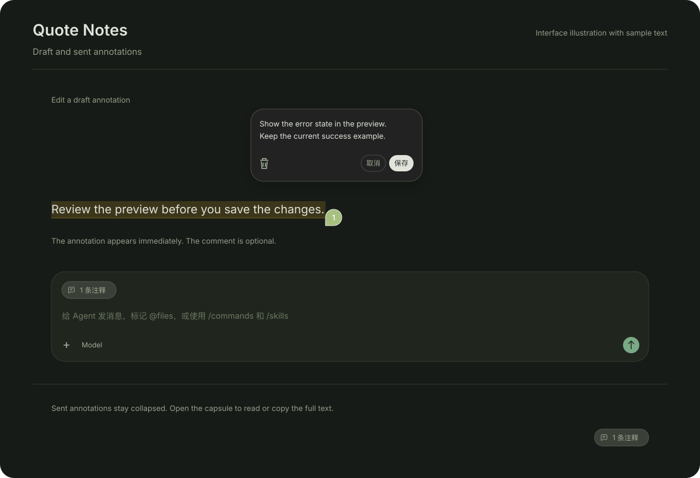

# Quote Notes

Select text in a Paseo agent chat, attach it as an annotation, and add an optional comment.
Draft and sent annotations collapse into an **n 条注释** capsule. You can also ask about a
selection in a side chat.



The preview illustrates the interface with sample data.

## Install

Quote Notes requires Paseo 0.11.2 or later. Enable plugins in **Settings > Plugins**.
Disable the original `quote` plugin before enabling Quote Notes. Running both is unsupported.

```bash
paseo plugin disable quote
paseo plugin add git:xzthemeofsss/paseo-quote-notes --ref v0.1.0
```

Skip the disable command if the original plugin is not installed. The new runtime ID is
`quote-notes`. Existing draft and sent attachments owned by `quote` remain readable.
Editing a legacy draft preserves its identity and metadata. New annotations use `quote-notes`.

## Add and edit annotations

Select chat text and click **添加到对话**. The annotation appears immediately. Add a comment
in **添加可选评论...**, or leave it empty and edit it later. Adding an annotation does not
send a message. Send the draft with Paseo's normal message controls.

In the new comment field, **Enter**, **Esc**, or leaving the field saves the current comment.
**Shift+Enter** inserts a line break. IME composition does not confirm the comment.

Hover or focus the **n 条注释** capsule to read the summary. Click to pin it. Click **编辑**
or a numbered source marker to open the edit card. The card stages changes until you click
**保存**, **Cmd+Enter** on macOS, or **Ctrl+Enter** elsewhere. **Enter** inserts a line break.
**取消**, **Esc**, or clicking outside discards unsubmitted changes. The trash button removes
that annotation.

Saving and deleting lock the card until the operation settles. If persistence is unconfirmed,
the attempted operation remains available for retry. Dismissing the card after an attempt
does not undo that operation. Resolve write errors before reloading or disabling the plugin.
Unsaved retry text lives only in memory.

Click a summary entry to return to its source. Source positions reset after a reload or source
replacement. **原文位置不可用** disables navigation while editing and removal remain available.
Quotes and saved comments persist in Paseo's native draft store.

## Read sent annotations

Click the sent **n 条注释** capsule, or press **Enter** or **Space**, to expand the complete
sent texts. **复制全文** copies an entry. **Esc** returns focus to the capsule, and clicking
outside closes it. Sent annotations are read only.

Paseo drops the separate comment metadata when sending. The expanded view keeps the complete
sent text, including the comment, without inferring a split. Unsupported and pending message
rows retain their native attachment cards. Disabling Quote Notes restores the native cards.

## Ask in a side chat

Select **在侧边聊天中提问**, enter a question, and press **Enter** or **Ask**. This creates a
child agent with the parent's provider, model, mode, and thinking level. The child receives
the selection, the source message when found, and up to eight recent main-chat turns.
The panel accepts follow-ups. **Open as tab** opens the child as a regular chat tab with the
full Paseo renderer.

## Data access and compatibility

Quote Notes is trusted client code. It reads selected chat text, the active agent and draft,
sent message attachments, and recent conversation text for side chats. It stores annotations
in the existing native draft and writes to the clipboard when you choose to copy an entry.
When you send the draft, Paseo sends the quote and comment through your configured agent
provider. Asking in a side chat sends the selection, question, and recent context to that
provider. The plugin adds no external backend and installs no software at runtime.

The native draft and sent-message adapters inspect private app interfaces and fetch the app's
own JavaScript bundles from the same origin. These interfaces are not a stable plugin API.
Compatibility checks reject unknown contracts, and a Paseo update can require an adapter update.
The annotation UI was verified on macOS desktop with Paseo 0.11.4 in a dark theme. Light themes,
browser clients, and mobile clients have not been independently verified. Selection actions
target desktop and web clients. Mobile platforms use their system selection menu. Annotation
controls currently use Chinese labels, and side chat controls include English.

## Develop

```bash
npm ci --ignore-scripts
npm run typecheck
npm test
```

The tests load the schema, store, persistence, converter, and keyboard focus resolver from the
installed macOS Paseo web bundle. Set `PASEO_BUNDLE` to another bundle path when needed. The
tests do not install the plugin or send agent messages. Runtime imports use Paseo's host
libraries, so installation needs no preparation command or runtime dependency install.

## Credits and license

Quote Notes is a fork of [paseo-quote by Chechulin Serhii](https://github.com/keefeere/paseo-quote).
It adds draft annotation editing, source markers, and sent annotation capsules. The original
[MIT license](LICENSE) and copyright notice are preserved.
